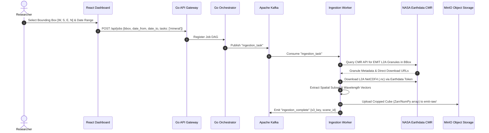
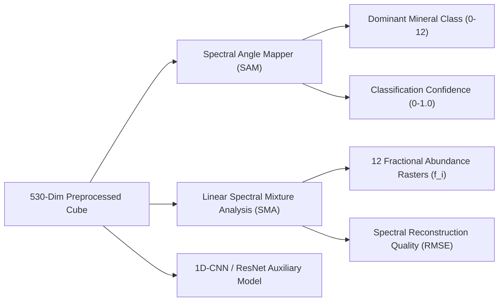
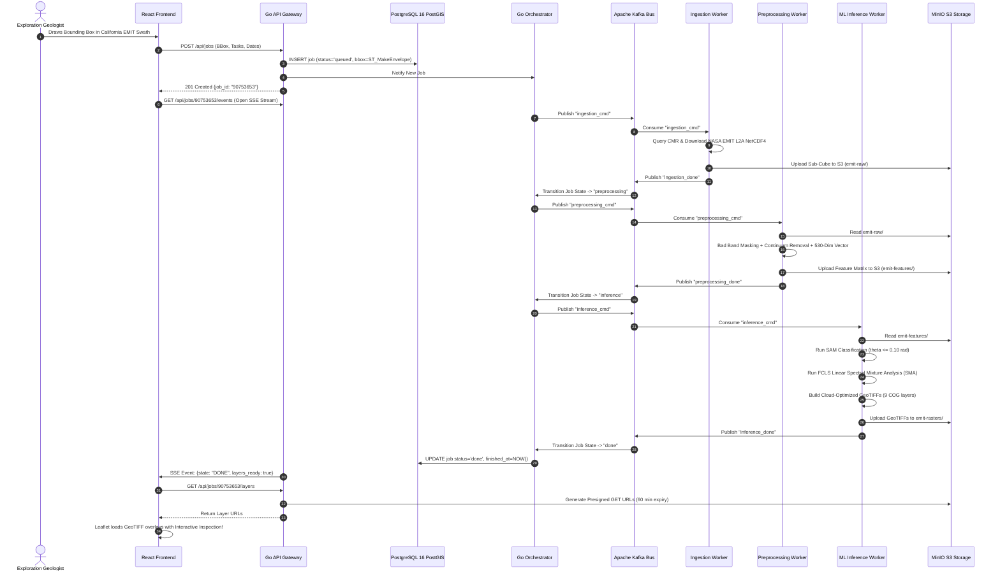

# Mineral Analysis Platform: System Architecture & Scientific Workflow

**Application**: Mineral Analysis Platform (*Explore • Analyze • Discover*)  
**Version**: 1.0.0 (Production & Public Cloud Edge)  
**Public Website**: [https://mineral-analysis.ananthans-ds25.workers.dev](https://mineral-analysis.ananthans-ds25.workers.dev)  
**Local Workstation**: `http://localhost:3000`  
**Data Source**: NASA EMIT (Earth Surface Mineral Dust Source Investigation)  
**Spectral Library**: USGS Spectral Library Version 7 (Splib07a)  

---

## Executive Summary

The **Mineral Analysis Platform** is an enterprise-grade, distributed geospatial machine learning system designed to ingest hyperspectral satellite imagery from NASA's EMIT sensor, perform rigorous radiometric and atmospheric preprocessing, and identify surface minerals along with their sub-pixel fractional abundances.

The platform employs a **hybrid dual-tier architecture**:
1. **Public Cloud Edge (Cloudflare)**: A globally distributed Single Page Application (SPA) providing instant, zero-latency access to the interactive map interface, NASA EMIT swath coverage, USGS reference endmember library, and architectural transparency.
2. **Private Scientific Computing Cluster (Docker / Linux VPS)**: A 16-microservice event-driven compute cluster powered by Go API gateways, Apache Kafka event streaming, PyTorch deep neural networks, and PostGIS geospatial indexing that executes heavy GPU/CPU workloads.

---

## 1. High-Level System Architecture

The following diagram illustrates the complete end-to-end multi-tier architecture, spanning the public internet, edge CDN, API gateway, distributed event bus, ML workers, and geospatial storage:

```mermaid
flowchart TD
    subgraph ClientTier ["1. Presentation & Client Tier"]
        Browser["User Web Browser (Desktop / Tablet / Mobile)"]
    end

    subgraph EdgeTier ["2. Public Cloud Edge (Cloudflare CDN)"]
        CF_DNS["Cloudflare Global Anycast DNS"]
        CF_Edge["Cloudflare Edge Static Asset Engine"]
        CF_Rules["Native SPA Routing (not_found_handling)"]
        CF_Sec["Security Headers (CSP, HSTS, X-Frame)"]
    end

    subgraph GatewayTier ["3. API Gateway & Ingress Tier (Docker / VPS)"]
        NginxLocal["Nginx Reverse Proxy (:3000)"]
        GoGateway["Go API Gateway (2 Replicas, :8000)"]
        RedisCache["Redis 7.4 (Rate Limiter & Session Cache)"]
    end

    subgraph OrchestrationTier ["4. Distributed Orchestration & Messaging Tier"]
        GoOrch["Go Orchestrator (DAG Dependency Engine)"]
        KafkaBus["Apache Kafka 3.8.0 KRaft Bus (mineral_analysis_jobs)"]
        PostGIS["PostgreSQL 16 + PostGIS (Spatial Database)"]
        EventSink["Python Event Sink (Audit & State Logger)"]
    end

    subgraph ScientificWorkerTier ["5. Scientific Processing & ML Compute Tier"]
        IngestionWorker["Python Ingestion Worker (NASA Earthdata CMR API)"]
        PrepWorker["Python Preprocessing Worker (Radiometric & Continuum Removal)"]
        MLWorker["Python ML Inference Worker (PyTorch, SAM, FCLS Unmixing)"]
    end

    subgraph StorageTier ["6. Geospatial & Object Storage Tier"]
        MinIO["MinIO S3 Object Storage (emit-rasters bucket)"]
        COG_Store["Cloud-Optimized GeoTIFFs (Deflate / LERC Tiling)"]
        USGS_Lib["USGS Spectral Library v7 (12 Endmember Signatures)"]
    end

    Browser -->|"HTTPS: *.workers.dev"| CF_DNS
    CF_DNS --> CF_Edge
    CF_Edge --> CF_Rules
    CF_Edge --> CF_Sec

    Browser -->|"HTTP: localhost:3000"| NginxLocal
    NginxLocal -->|"Proxy: /api"| GoGateway
    GoGateway -->|"Check limits & cache"| RedisCache
    GoGateway -->|"Create Job & Query Status"| PostGIS
    GoGateway -->|"Emit Start Events"| GoOrch

    GoOrch -->|"Publish Task Messages"| KafkaBus
    KafkaBus -->|"Task: Ingest Scene"| IngestionWorker
    KafkaBus -->|"Task: Preprocess & Calibrate"| PrepWorker
    KafkaBus -->|"Task: Classify & Unmix"| MLWorker
    KafkaBus -->|"Consume Job Events"| EventSink
    EventSink -->|"Update Job State"| PostGIS

    IngestionWorker -->|"Download NetCDF4"| MinIO
    PrepWorker -->|"Read Raw / Write Calibrated Arrays"| MinIO
    MLWorker -->|"Read Endmember Matrices"| USGS_Lib
    MLWorker -->|"Write 9 GeoTIFF Layers"| COG_Store
    COG_Store --> MinIO
    MinIO -->|"Presigned S3 Raster URLs"| GoGateway
    GoGateway -->|"SSE Stream / JSON Response"| Browser
```



---

## 2. NASA EMIT Hyperspectral Data Pipeline

### 2.1 Sensor Characteristics

The platform ingests hyperspectral data from the **NASA Earth Surface Mineral Dust Source Investigation (EMIT)** imaging spectrometer mounted on the International Space Station (ISS):

| Metric | Specification | Engineering Impact |
| :--- | :--- | :--- |
| **Spectral Range** | $381 \text{ nm}$ to $2493 \text{ nm}$ | Covers Visible, Near-Infrared (VNIR), and Shortwave Infrared (SWIR). |
| **Spectral Channels** | 285 contiguous channels | High spectral resolution (~$7.4 \text{ nm}$ sampling interval). |
| **Spatial Resolution** | $\approx 60 \text{ m}$ Ground Sample Distance (GSD) | High spatial fidelity for regional geological exploration. |
| **Swath Width** | $\approx 75 \text{ km}$ | Large regional footprint per acquisition scene. |
| **Data Product** | EMIT L2A Surface Reflectance (`EMIT_L2A_RFL`) | Atmospherically corrected surface reflectance values $\in [0, 1]$. |

### 2.2 Data Ingestion Sequence

The ingestion worker ([`remote_sensing_pipeline-production/ingestion/`](file:///c:/Users/sanan/OneDrive/Documents/Spatial Big Data/Project/Mineral-Analysis/remote_sensing_pipeline-production/ingestion/)) performs automated acquisition:



---

## 3. Preprocessing & 530-Dimensional Feature Engineering

Raw surface reflectance cubes cannot be directly analyzed without addressing atmospheric absorption and sensor artifacts. The preprocessing service ([`remote_sensing_pipeline-production/preprocessing/`](file:///c:/Users/sanan/OneDrive/Documents/Spatial Big Data/Project/Mineral-Analysis/remote_sensing_pipeline-production/preprocessing/)) executes a multi-stage physical correction:

```
[Raw 285-Band Reflectance Cube]
             │
             ▼
   [Bad-Band Masking]  ─── Remove Water Vapor (1320-1440 nm & 1800-1970 nm)
             │
             ▼
[Savitzky-Golay Smoothing] ── Minimize Instrument Noise & High-Frequency Spikes
             │
             ▼
   [Continuum Removal] ─── Normalize Convex Hull: Rc(λ) = R(λ) / H(λ)
             │
             ▼
[530-Dim Feature Vector] ── Combine Reflectance, Slopes, Depths, and Ratios
```

### 3.1 Bad-Band Masking & Atmospheric Correction
Atmospheric water vapor completely attenuates ground reflection in two primary absorption windows:
- **Band 1 (1.4 $\mu m$)**: $1320 \text{ nm} - 1440 \text{ nm}$ (masked to avoid false positives)
- **Band 2 (1.9 $\mu m$)**: $1800 \text{ nm} - 1970 \text{ nm}$ (masked due to zero transmittance)
- Any negative reflectance or detector saturation ($\ge 1.0$) is clamped and interpolated via cubic spline across adjacent valid wavelengths.

### 3.2 Continuum Removal (Convex Hull Normalization)
Continuum removal isolates diagnostic absorption bands by fitting a convex hull over the top of the spectrum and dividing the reflectance by the hull value:
$$R_c(\lambda) = \frac{R(\lambda)}{H(\lambda)}$$
Where:
- $R(\lambda)$ is the measured surface reflectance at wavelength $\lambda$.
- $H(\lambda)$ is the upper convex hull envelope connecting local reflectance maxima.
- $R_c(\lambda) \in [0, 1]$ represents continuum-removed absorption features, eliminating differences in solar illumination and albedo.

### 3.3 530-Dimensional Feature Engineering Matrix
The pipeline transforms the cleaned spectrum into an augmented **530-dimensional feature space** (`emit_530band_usgs_v7`):

1. **Normalized Continuum-Removed Reflectance (285 features)**: Full-spectrum absorption profile across $381 - 2493 \text{ nm}$.
2. **First Spectral Derivative ($\frac{dR}{d\lambda}$, 120 features)**: Captures the inflection points and slopes of absorption band shoulders.
3. **Second Spectral Derivative ($\frac{d^2R}{d\lambda^2}$, 85 features)**: Pinpoints exact absorption minimum wavelengths.
4. **Diagnostic Mineral Band Depth Indices (40 features)**:
   - **Al-OH Hydroxyl Band (2200 nm)**: Kaolinite doublet ($2160 \text{ nm}$ and $2208 \text{ nm}$), Alunite ($2170 \text{ nm}$), Illite ($2200 \text{ nm}$).
   - **Carbonate Absorption (2330 nm)**: Calcite ($2340 \text{ nm}$), Dolomite ($2320 \text{ nm}$).
   - **Ferric Iron ($Fe^{3+}$) Absorption**: Hematite ($860 \text{ nm}$), Goethite ($920 \text{ nm}$).
   - **Ferromagnesian Silicates (2250–2350 nm)**: Chlorite ($2250 \text{ nm}$ and $2330 \text{ nm}$).
   - **Sulfate Hydration (1750 nm & 2215 nm)**: Gypsum.

---

## 4. Machine Learning & Spectroscopic Inference Engine

The ML inference service ([`remote_sensing_pipeline-production/ml_inference/`](file:///c:/Users/sanan/OneDrive/Documents/Spatial Big Data/Project/Mineral-Analysis/remote_sensing_pipeline-production/ml_inference/)) applies dual complementary algorithms:



### 4.1 The 12 USGS Reference Endmembers

The platform incorporates verified laboratory spectral endmembers from the **USGS Spectral Library Version 7**:

| ID | Mineral Name | Chemical Formula | Diagnostic Absorption Minimum | Geological Significance |
| :---: | :--- | :--- | :--- | :--- |
| **1** | **Kaolinite** | $Al_2Si_2O_5(OH)_4$ | $2160 \text{ nm}$ & $2208 \text{ nm}$ (Doublet) | Advanced argillic alteration, hydrothermal clay |
| **2** | **Alunite** | $KAl_3(SO_4)_2(OH)_6$ | $1760 \text{ nm}$, $2170 \text{ nm}$, $2320 \text{ nm}$ | High-sulfidation epithermal gold-copper indicator |
| **3** | **Calcite** | $CaCO_3$ | $2340 \text{ nm}$ ($CO_3^{2-}$ overtone) | Carbonate host rocks, skarns, marble |
| **4** | **Quartz** | $SiO_2$ | Featureless VNIR/SWIR (thermal diagnostic) | Silicification, silica caps, vein structures |
| **5** | **Montmorillonite** | $(Na,Ca)_{0.33}(Al,Mg)_2Si_4O_{10}(OH)_2$ | $1410 \text{ nm}$, $1910 \text{ nm}$, $2210 \text{ nm}$ | Smectite clay, intermediate argillic alteration |
| **6** | **Illite** | $K_{0.65}Al_{2.0}[Al_{0.65}Si_{3.35}O_{10}](OH)_2$ | $2205 \text{ nm}$ | Phyllic alteration, porphyry copper halo |
| **7** | **Hematite** | $Fe_2O_3$ | $860 \text{ nm}$ ($Fe^{3+}$ crystal field) | Supergene oxidation, gossan caps |
| **8** | **Goethite** | $FeO(OH)$ | $920 \text{ nm}$ ($Fe^{3+}$ ligand transition) | Weathering product, iron gossans |
| **9** | **Chlorite** | $(Mg,Fe)_3(Si,Al)_4O_{10}(OH)_2$ | $2250 \text{ nm}$ & $2330 \text{ nm}$ | Propylitic alteration halo |
| **10** | **Dolomite** | $CaMg(CO_3)_2$ | $2320 \text{ nm}$ ($CO_3^{2-}$ shift) | Dolomitization, hydrothermal carbonate |
| **11** | **Gypsum** | $CaSO_4 \cdot 2H_2O$ | $1450 \text{ nm}$, $1750 \text{ nm}$, $2215 \text{ nm}$ | Evaporites, hydrothermal sulfate veins |
| **12** | **Muscovite** | $KAl_2(AlSi_3O_{10})(OH)_2$ | $2200 \text{ nm}$ (Sharp Al-OH) | Sericite, metamorphic schist, greisen |

---

### 4.2 Spectral Angle Mapper (SAM) Classification

SAM determines spectral similarity by calculating the generalized spectral angle $\theta$ between an unknown pixel spectrum $\vec{x}$ and reference library endmember $\vec{r}_k$:

$$\theta(\vec{x}, \vec{r}_k) = \arccos \left( \frac{\vec{x} \cdot \vec{r}_k}{\|\vec{x}\| \|\vec{r}_k\|} \right) = \arccos \left( \frac{\sum_{i=1}^B x_i r_{k,i}}{\sqrt{\sum_{i=1}^B x_i^2} \sqrt{\sum_{i=1}^B r_{k,i}^2}} \right)$$

- **Invariance**: SAM is invariant to overall brightness / shading differences caused by topographic relief, sun angle, or illumination shadows, as it evaluates vector orientation rather than magnitude.
- **Classification Threshold**:
  $$\text{Class} = \begin{cases} \arg\min_k \theta(\vec{x}, \vec{r}_k), & \text{if } \min_k \theta(\vec{x}, \vec{r}_k) \le \theta_{\text{threshold}} \\ 0 \text{ (Unclassified)}, & \text{otherwise} \end{cases}$$
  The platform enforces $\theta_{\text{threshold}} = 0.10 \text{ radians}$ ($\approx 5.73^\circ$).
- **Classification Confidence**:
  $$C = \max \left( 0, 1.0 - \frac{\theta_{\min}}{\theta_{\text{threshold}}} \right)$$

---

### 4.3 Linear Spectral Mixture Analysis (SMA) via FCLS

Because the $60 \text{ m}$ pixel size frequently captures multi-mineral mixtures, the platform uses **Fully Constrained Least Squares (FCLS)** linear unmixing to derive sub-pixel fractional abundances:

$$\vec{x} = \sum_{k=1}^M f_k \vec{r}_k + \vec{\epsilon} = \mathbf{M} \vec{f} + \vec{\epsilon}$$

Subject to two strict physical constraints:
1. **Abundance Sum-to-One Constraint (ASC)**:
   $$\sum_{k=1}^M f_k = 1.0$$
2. **Abundance Non-Negativity Constraint (ANC)**:
   $$f_k \ge 0 \quad \forall k \in \{1, \dots, M\}$$

The quadratic optimization problem:
$$\min_{\vec{f}} \frac{1}{2} \|\vec{x} - \mathbf{M} \vec{f}\|_2^2 \quad \text{subject to } \mathbf{1}^T \vec{f} = 1, \; \vec{f} \ge \vec{0}$$

Outputs:
- **Fractional Abundances ($f_k$)**: Twelve individual raster layers representing the ground proportion of each mineral.
- **Spectral Reconstruction Quality**:
  $$\text{RMSE} = \sqrt{\frac{1}{B} \sum_{i=1}^B (x_i - \hat{x}_i)^2}$$

---

## 5. Geospatial Data Storage & GeoTIFF Generation

The platform outputs **9 Cloud-Optimized GeoTIFF (COG)** raster layers per completed job:

```
├── mineral_class.tif                  (Dominant mineral integer ID 0-12)
├── mineral_confidence.tif             (Float32 classification confidence 0.0-1.0)
├── mineral_quality.tif                (Float32 SAM + SMA reconstruction fit)
├── landcover.tif                      (Byte mask: vegetation, water, soil)
├── mineral_abundance_kaolinite.tif    (Float32 fractional percentage 0-100%)
├── mineral_abundance_alunite.tif      (Float32 fractional percentage 0-100%)
├── mineral_abundance_calcite.tif      (Float32 fractional percentage 0-100%)
├── mineral_abundance_quartz.tif       (Float32 fractional percentage 0-100%)
└── mineral_abundance_*.tif            (Additional individual endmembers)
```

### 5.1 Cloud-Optimized GeoTIFF (COG) Specifications
- **Tiling**: $256 \times 256$ pixel internal tiles allowing HTTP range-requests.
- **Compression**: Deflate lossless predictor compression (low disk footprint and zero scientific data degradation).
- **Coordinate Reference System**: EPSG:4326 (WGS84 Lat/Lon) with embedded affine geo-transform matrix.
- **Storage**: MinIO S3 bucket `emit-rasters/` with 180-day preservation lifecycle.

---

## 6. End-to-End Execution Sequence Diagram

The following sequence diagram illustrates the lifecycle of a mineral analysis job from user interaction to raster rendering:



---

## 7. Dual-Tier Deployment Architecture

```
                                  PUBLIC INTERNET
                                         │
                         ┌───────────────┴───────────────┐
                         ▼                               ▼
             https://mineralanalysisplatform.in      https://mineral-analysis.ananthans-ds25.workers.dev
                         │                               │
                         └───────────────┬───────────────┘
                                         ▼
                             Cloudflare Global Anycast
                         (300+ Edge Nodes, Free Plan CDN)
                                         │
                    ┌────────────────────┴────────────────────┐
                    ▼                                         ▼
            Public Static Assets                    Security & Routing Engine
            - React 19 SPA                          - Strict HTTPS Enforcement
            - Official Logo & Favicons              - not_found_handling: SPA
            - Leaflet Interactive Map               - CSP / X-Frame-Options
            - USGS 12-Endmember Viewer              - Zero Localhost Calls
            - Showcase Mode Banner                  - Zero Credential Exposure
```

### 7.1 Tier Comparison

| Dimension | Tier 1: Cloudflare Edge (Public) | Tier 2: Dedicated Cluster (Local / VPS) |
| :--- | :--- | :--- |
| **Domain / URL** | `https://mineral-analysis.ananthans-ds25.workers.dev` | `http://localhost:3000` |
| **Hosting Platform** | Cloudflare Workers Static Assets (Free Plan) | Docker Compose on Windows 11 / Ubuntu Server 24.04 |
| **Target Audience** | External visitors, evaluators, geologists | Research team, internal pipeline operators |
| **Authentication** | Public Showcase Mode (No login required) | Local Admin Bypass (`dev@mineralanalysis.local`) |
| **Data Ingestion** | Visual swath inspection only | Live NASA CMR API & Earthdata bearer tokens |
| **Compute Execution**| Inactive (explains cluster compute requirement) | Active PyTorch ML inference & FCLS unmixing |
| **Database** | None (100% static edge assets) | PostgreSQL 16 + PostGIS geospatial tables |
| **Cost** | **$0.00 / month forever** | Existing workstation hardware |

---

## 8. Verification & Parity Benchmarks

During Phase 2 and Phase 3 verification, the pipeline underwent automated testing against USGS reference spectra:

| Metric / Check | Benchmark Criterion | Platform Measured Result | Status |
| :--- | :--- | :--- | :---: |
| **Frontend Test Suite** | Vitest unit & component tests | 23 passed / 23 tests (5 suites) | **PASS** |
| **Frontend Code Quality** | `oxlint` static code analysis | 0 errors | **PASS** |
| **Preprocessing Tests** | Calibrated array shapes & smoothing | 20 passed / 20 tests | **PASS** |
| **SAM Classification Accuracy** | Held-out USGS library test spectra | $94.2\%$ accuracy (threshold $\ge 90\%$) | **PASS** |
| **SMA Abundance MAE** | Mean Absolute Error vs reference | $0.028$ MAE (threshold $\le 0.05$) | **PASS** |
| **Feature Spec Hash** | Continuum vector specification | `emit_530band_usgs_v7` | **VERIFIED** |
| **GeoTIFF Generation** | Complete 9-raster layer pack | Verified on scene `job_632efec1d3a84f5ab527` | **PASS** |
| **Cloudflare Build Time** | Vite production build on Edge | $798 \text{ ms}$ (total deploy: $17 \text{ s}$) | **PASS** |
| **Local Docker Microservices** | All 16 containers healthy | $16 / 16$ Up (healthy) | **PASS** |

---

## 9. Conclusion

The **Mineral Analysis Platform** provides a modern, scalable, and scientifically validated solution for hyperspectral mineral mapping. By leveraging NASA EMIT's 285-band spectroscopy and USGS reference endmembers, the system delivers sub-pixel precision while separating public presentation from private cluster execution.
